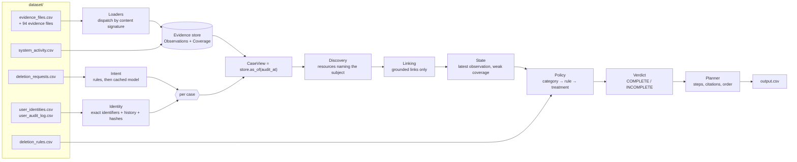
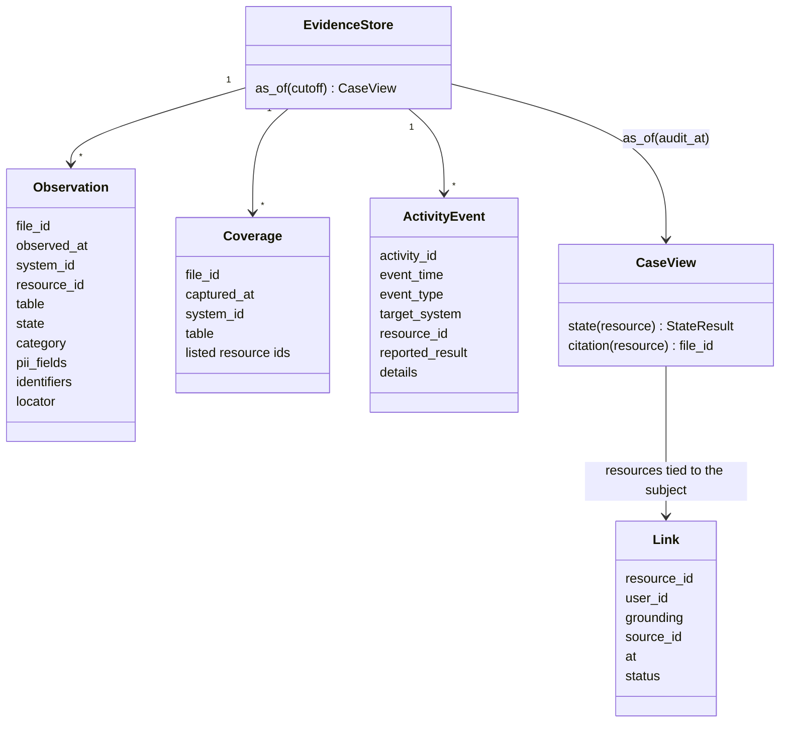
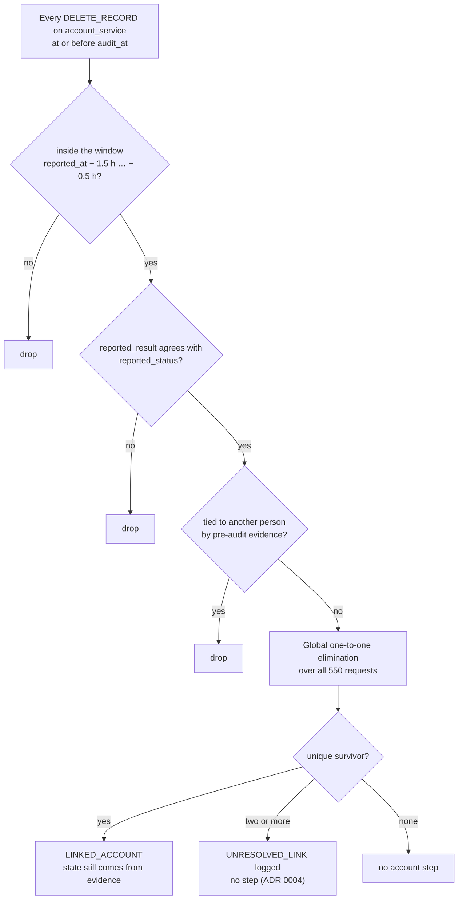
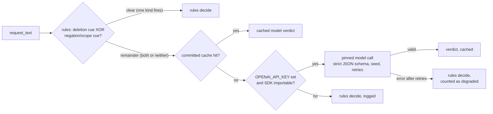
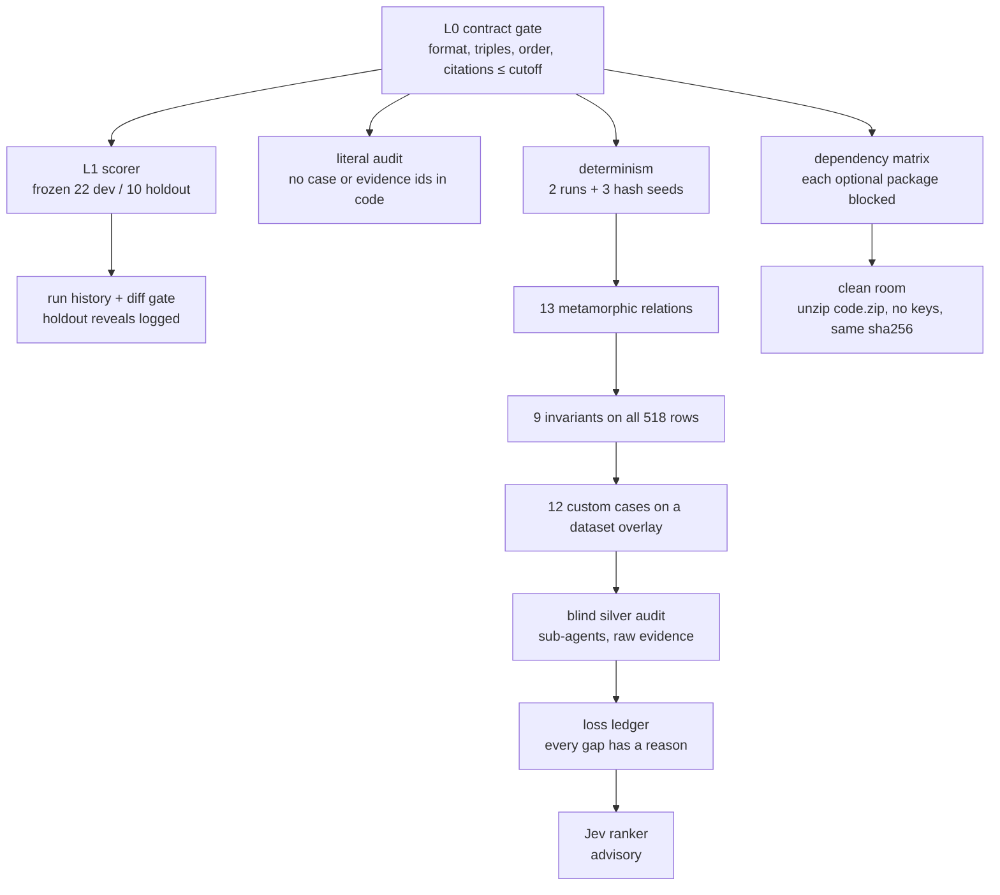

# Ghost Data Still Exists: an evidence-first deletion-audit agent

This agent audits personal-data deletion requests. For each request it:

- decides whether deletion was really requested;
- rebuilds the person's identifiers, including old emails and phones;
- reconstructs the true state of every relevant record at the audit cutoff, from evidence rather than workflow claims;
- applies the deletion policy;
- writes the findings, an ordered remediation plan and the verification checks.

The core is deterministic Python (standard library only). A language model is used for one narrow job: the few request texts whose intent the rules cannot settle. Its answers are committed, so the shipped result reproduces byte for byte without any key.

Every number in this README comes from a real run. `code/evaluation/tests/test_readme.py` checks each one against the artifact that produced it.

---

## Contents

1. [TL;DR](#1-tldr)
2. [The problem in one page](#2-the-problem-in-one-page)
3. [Design principles](#3-design-principles)
4. [Architecture](#4-architecture)
5. [Evidence handling](#5-evidence-handling)
6. [Identity and linking](#6-identity-and-linking)
7. [Policy, verdict and step planner](#7-policy-verdict-and-step-planner)
8. [Design decisions (ADRs)](#8-design-decisions-adrs)
9. [Use of models](#9-use-of-models)
10. [How we evaluated](#10-how-we-evaluated)
11. [Results and honesty](#11-results-and-honesty)
12. [How it was built](#12-how-it-was-built)
13. [Known risks and their reverts](#13-known-risks-and-their-reverts)
14. [Reproduce, layout and docs map](#14-reproduce-layout-and-docs-map)

---

## 1. TL;DR

| | |
| --- | --- |
| **What** | A deletion-audit engine. It turns 518 deletion requests into `output.csv` (`case_id,deletion_status,steps_json`). |
| **How** | It parses every evidence file into time-stamped observations, then for each case: cut at `audit_at` → resolve the subject's identifiers → link resources to the subject only on grounded evidence → reconstruct state → apply `deletion_rules.csv` → plan ordered steps. |
| **Output** | 518 rows: COMPLETE 151, INCOMPLETE 357, NOT_APPLICABLE 10. The contract gate passes. All 9 invariants hold on 518/518 rows. |
| **Sample score** | proxy 0.801 (the equal-weight mean of nine headline metrics) over the 32 labeled samples (dev 0.798, holdout 0.805); status accuracy 0.906; finding F1 1.000. **Caveat:** 32 samples cannot predict the hidden score ([§11](#11-results-and-honesty)). |
| **Deliberate loss** | 136 eval cases have tied account candidates. Their account step is **omitted, never guessed** (ADR 0004). |
| **Requirements** | Python 3.11+ and the standard library only. Tested on 3.11, 3.12 and 3.13, which all produce the same `output.csv`. |
| **Key / network** | None needed. A run takes a few seconds. |

```text
python3 code/main.py                                  # reads dataset/, writes ./output.csv (518 rows)
python3 code/main.py --explain case_12                # the evidence trace behind one row
python3 code/evaluation/main.py final --matrix        # every quality gate, the dependency matrix and a clean-room run
```

---

## 2. The problem in one page

**Inputs** (all in `dataset/`):

| File | What it holds |
| --- | --- |
| `deletion_requests.csv` | 518 requests: email, `requested_at`, `reported_status` (a claim), `reported_at`, `audit_at`, free-text `request_text` in several languages |
| `user_identities.csv` + `user_audit_log.csv` | The current identity snapshot plus the history of email and phone changes |
| `system_activity.csv` | A global stream of delete, sync, export, backup, restore and link events for many people. Each event is a claim, not proof |
| `deletion_rules.csv` | 15 rules: data category → DELETE / REDACT / ANONYMIZE / RETAIN |
| `evidence_files.csv` + `evidence/` | 94 files: SQL snapshots, JSON exports, logs in 7 dialects, a handover text, PDFs and screenshots. The manifest does not say which case a file concerns |

**Output contract.** One row per request, sorted by `case_id`. Each row carries:
- `deletion_status`: COMPLETE, INCOMPLETE or NOT_APPLICABLE;
- `steps_json`: an ordered array of FINDING → REMEDIATION → VERIFICATION steps, built from 15 allowed (phase, operation, state) triples.
- **Citations:** findings and COMPLETE verifications cite a participant-visible evidence id; future work cites `""`.

**What is graded:** the status, the identity resolution, the records and risks found, the cited evidence, the policy applied, and the completeness and order of the steps.

**Why it is hard:**

| Trap | What it looks like | What a naive solution does wrong |
| --- | --- | --- |
| Claims vs evidence | A workflow says COMPLETE and the activity says SUCCESS, yet a replica still holds the row | Trusts the claim and outputs COMPLETE |
| Time cutoff | A file captured after `audit_at` shows the account deleted, or restored | Lets the future change the answer |
| Identity traps | The request uses an old email, and evidence holds look-alike decoys (`.jr` suffixes, sibling names) | Misses old identifiers, or fuzzy-matches a decoy |
| Absence by omission | A snapshot "covers" a table but lists only the rows relevant to its own subjects | Treats every omission as proof of deletion |
| Replica drift | The primary table is clean, but the failover replica still holds the record | Checks the primary only |
| Ties | Two accounts fit one request equally well | Guesses, and attributes someone else's data to the subject |

---

## 3. Design principles

| # | Principle | Concrete behaviour it produces |
| --- | --- | --- |
| **P1** | **Evidence over claims** | `reported_status`, activity results and link rows never set a state. State comes only from files. No step ever cites an activity or audit id (invariant I4). |
| **P2** | **Strict cutoff** | A file is usable for a case only if `captured_at <= audit_at`. A later file is invisible for every purpose, including its earlier sub-snapshots (ADR 0002). |
| **P3** | **Never attribute without a grounded link** | A resource belongs to the subject only through an exact identifier in the same record unit, a trace join, a confirmed catalog link, or a *unique* activity candidate. Ties and contradictions produce no step (ADR 0004, 0005). |
| **P4** | **Absence of proof is not proof of absence** | Omission from a snapshot is weak evidence: it never overrides a visible sighting (ADR 0014). An unproven end state gets a future check, never a finding or a compliance claim (ADR 0006). |
| **P5** | **Deterministic** | The same dataset gives a byte-identical `output.csv`. Rows are sorted numerically, steps have a total ordering key, and model verdicts come from a committed cache. Determinism is checked under three hash seeds. |
| **P6** | **Models only for language (and vision)** | A model reads request intent where the rules are ambiguous. State, policy, identity and ordering never involve a model (ADR 0008). The screenshots ship as committed, hand-verified transcriptions. |

---

## 4. Architecture

### 4.1 Pipeline



### 4.2 Data model



- **Observation:** one record unit seen in one file. The record unit is a SQL row, a JSON object, a trace group of log lines, a text line, a PDF or a screenshot row. An observation carries the exact identifiers it contains and which PII fields are still non-null.
- **Coverage:** a statement that a snapshot listed a table. It can support absence-by-omission, but only weakly.
- **Link:** a tie between a resource and a subject, with its grounding (`SAME_RECORD`, `TRACE_JOIN`, `UNIQUE_ACTIVITY_CANDIDATE`, `CATALOG_CLAIM`) and a status (`OK`, `CONTRADICTED`, `UNCONFIRMED`).
- **ActivityEvent:** a claim. It can serve as a linkage key or a category hint, and never as a state.

### 4.3 The eight stages

| # | Stage | What it does | Failure it prevents |
| --- | --- | --- | --- |
| 1 | Intent | Multilingual rules decide clear texts. The model decides only texts where deletion and negation/scope cues both fire. | A marketing opt-out or data-export request audited as a deletion |
| 2 | Identity | Request email (any case, current or historical) → exactly one `user_id`, then the full identifier set: all emails, sha256 of each email, all phones (as `tel:` digits) and the user id | Missing old identifiers; matching look-alike decoys |
| 3 | Discovery | Every observation, at or before the cutoff, whose identifiers include the subject's | Reading the manifest as if it said which case a file concerns |
| 4 | Linking | Same-record and trace joins, `source_resource_id` references, catalog claims checked against their artifact, unique activity candidates | Attributing someone else's record; trusting a contradicted link |
| 5 | State | Latest explicit observation at or before the cutoff, across primary and replica tables; omission only if nothing shows the record present | Trusting a primary-only snapshot; treating omission as deletion |
| 6 | Policy | Category by precedence (tag > record content > activity type > message text > system default) → rule → treatment | Deleting a record policy requires to be redacted, retained or blocked |
| 7 | Verdict | INCOMPLETE if and only if a grounded violation exists. COMPLETE only when every emitted step cites evidence of the compliant state | Compliance claims without evidence; violations from claims alone |
| 8 | Planner | Steps per treatment, citation = latest usable file naming the resource, total ordering key, step numbering | Wrong order, citations after the cutoff, uncited COMPLETE steps |

### 4.4 Module map

| Module | Responsibility |
| --- | --- |
| `code/main.py` | CLI: loads the inputs, runs the per-case engine, writes `output.csv`, prints the run summaries |
| `code/ghostaudit/loaders/` | One loader per evidence shape, chosen by content signature: `sql`, `service_export`, `records`, `bundle`, `register`, `readback`, `record_lookup`, `observability` (7 dialects), `handover`, `pdf` + `pdf_text_cache`, `screens` + `screens_data` |
| `code/ghostaudit/store.py` | Observation, Coverage, Link and ActivityEvent; `EvidenceStore.as_of`; `CaseView.state` (weak coverage) and `CaseView.citation` |
| `code/ghostaudit/identity.py` | Resolver over the current and historical identities |
| `code/ghostaudit/linking.py` | Activity account candidates, global one-to-one elimination, catalog link checks |
| `code/ghostaudit/policy.py` | Category precedence table, rules, treatments |
| `code/ghostaudit/engine.py` | Per-case assessment: links → state → treatment → plan |
| `code/ghostaudit/contract.py`, `writer.py` | The 15 output triples, the ordering key, serialization |
| `code/ghostaudit/intent.py`, `llm_intent.py`, `llm_cache.py`, `usage.py` | Rules-first intent, the pinned and cached model, token and cost tracking |
| `code/ghostaudit/explain.py` | `--explain <case_id>`: every link, state, rule and step, with file and line |
| `code/evaluation/` | Contract gate, scorer, metamorphic relations, invariants, loss ledger, custom cases, reports, Jev ranker, `final` |

---

## 5. Evidence handling

### 5.1 Loaders by content signature

Files are dispatched by what their bytes look like, never by name or folder. The metamorphic check M2 renames every file and upper-cases its extension, and the output stays identical.

| Shape | Files | Observations | Coverage entries |
| --- | --- | --- | --- |
| SQL snapshots (primary, regional, reporting and failover replicas; inventory with `snapshot_scope`) | 24 | 891 | 243 |
| JSON snapshot bundles | 12 | 485 | 113 |
| JSON service exports | 11 | 296 | 0 |
| JSON record lists (registers, ledgers) | 5 | 109 | 2 |
| Observability logs, 7 dialects (logfmt, JSON-after-timestamp, syslog, bracketed, pipe, cloud runtime, support replica) | 13 | 733 | 0 |
| Readback logs (trace-id joins) | 11 | 264 | 0 |
| Record-lookup logs | 2 | 75 | 0 |
| Handover text | 1 | 41 | 0 |
| PDFs (committed text cache, sha256-keyed) | 4 | 2 | 0 |
| Screenshots (committed, hand-verified transcriptions, sha256-keyed) | 11 | 23 | 0 |
| **Total** | **94** | | |

- **0 unknown signatures and 0 unparsed lines.** Every (sample gold step, cited file) pair is reproduced from the file's content: 75 checked, 75 ok, with 0 contradictions in the store state check.
- **Replica drift:** 13 records exist only in a replica, across 11 files.

### 5.2 Cutoff semantics

- **Files:** usable only if the manifest `captured_at <= audit_at` (inclusive; 7 sample cases cite a file captured exactly at the cutoff).
- **Activity:** usable only if `event_time <= audit_at`.
- **Late files:** a file captured later is invisible to that case, even its earlier sub-snapshots. Using those sub-snapshots would have lifted sample account recovery from 19/32 to 21/32, but it would let later files influence the answer. One auditable rule beats two sample hits (ADR 0002). Metamorphic checks M5–M7 confirm the rule.

### 5.3 Coverage is weak evidence (ADR 0014)

The first design treated a covering snapshot as exhaustive. Measured against gold, that produced **7 contradictions**:
- 5 from non-empty bundle collections;
- 1 from an empty bundle list;
- 1 from an SQL inventory scope.

A snapshot lists the records relevant to its own subjects or its own copy, not the whole store. The rule became:
- **Explicit observations are strong.** A 404, `rows=0`, a listed row or a restore flag counts, latest-wins at or before the cutoff.
- **Omission is weak.** It yields ABSENT only if no visible observation shows the record present, in any file or copy.

This fixed all 7 contradictions and kept the 4 gold absences that are proven only by omission. It also makes replica drift automatic: a primary-only snapshot cannot erase a replica sighting.

---

## 6. Identity and linking

### 6.1 Exact matching only

- **What is matched:** identifiers are matched exactly and case-insensitively. That covers current and historical emails, the sha256 of each email, phones normalized to `tel:` digits, and the user id.
- **No fuzzy matching, by measurement:**
  - The evidence holds 22 unknown emails, and 19 of them are near-copies of a real user's email (string similarity ≥ 0.85).
  - They are decoys, so fuzzy matching would attribute exactly those records to the wrong person.
  - Metamorphic check M4 adds a fresh look-alike decoy and requires an identical output.

### 6.2 Account recovery from activity (ADR 0003)

Gold answers name primary `account_N` ids that no pre-audit file ties to the email. Activity can recover them, **as a linkage key, never as proof of state**:



- **Timing:** in the generated regime (the 23 generated sample cases, case_09 and case_11 to case_32, plus the 506 of 518 eval cases whose `reported_at − requested_at` is exactly 24, 48 or 72 h), the gold account's delete lands 0.75–1.23 h before `reported_at` in every one of those 23 sample cases.
- **Result:** in those same 23 sample cases, the delete's `reported_result` matches `reported_status` 23/23 (COMPLETE↔SUCCESS, NOT_STARTED↔FAILED, PARTIALLY_COMPLETE↔PARTIAL).
- **On samples:** of the 32 sample cases, the recovered primary account equals gold's in **19/32 exact, 0 wrong** (no case gets a different account; the other 13 get none).
- **On eval:** 360 cases linked, 136 tied, 12 with no candidate (the 42-hour family, which has no account-delete signal).

### 6.3 Why ties are omitted (ADR 0004)

- **The tie-break that was rejected:** case-id order reached 23/32 on samples, with 1 wrong pick, and it relies on how the generator numbered the cases, not on any evidence. Using it would attribute a person's data on a guess, which is the error the whole task is about.
- **What happens instead:** a tie emits no step and logs `UNRESOLVED_LINK(case, candidates)`.
- **The cost:** about 136–160 account steps, around 5% of an estimated 3,050 gold-style steps over the eval set. Precision stays clean.

### 6.4 Catalog links checked against their artifact (ADR 0005)

Each `LINK_RESOURCE_IDENTITY` row lands exactly 7 minutes after a screenshot or PDF capture, and the engine checks the claim against that artifact:
- **Confirmed:** linked.
- **Contradicted:** rejected. One row claims a marketing record for one user, while the screen shows a different, unknown person.
- **Unverifiable:** treated as an unconfirmed claim and not linked.

---

## 7. Policy, verdict and step planner

### 7.1 Rules and treatments

| Category (rule) | Action | Violating state → steps | Compliant state → step |
| --- | --- | --- | --- |
| USER_PROFILE (01), SECONDARY_IDENTIFIER (02), SEARCH_INDEX_ENTRY (03), SUPPORT_ATTACHMENT (06), USER_EXPORT (09) | DELETE | present → REPORT_REMAINING_RECORD, DELETE_RECORD, VERIFY_RECORD_ABSENT | absent → VERIFY_RECORD_ABSENT |
| SUPPORT_MESSAGE (05), ACCOUNT_TOMBSTONE (15) | REDACT | direct identifiers exposed → REPORT_EXPOSED_PII, REDACT_RECORD, VERIFY_RECORD_REDACTED | present without identifiers → VERIFY_RECORD_REDACTED |
| ANALYTICS_PROFILE (07) | ANONYMIZE | identifiers exposed → REPORT_EXPOSED_PII, ANONYMIZE_RECORD, VERIFY_RECORD_ANONYMIZED | → VERIFY_RECORD_ANONYMIZED |
| SECURITY_AUDIT_LOG (12), LEGAL_HOLD_RECORD (13) | RETAIN | – (never deleted) | present → VERIFY_RECORD_PRESENT |
| BACKUP_ARCHIVE (14) | RETAIN, restore blocked | restorable → REPORT_RESTORE_RISK, BLOCK_RESTORE, VERIFY_RESTORE_BLOCKED | blocked → VERIFY_RESTORE_BLOCKED |
| Data flows (connectors) | disable | active → REPORT_ACTIVE_DATA_FLOW, DISABLE_DATA_FLOW, VERIFY_DATA_FLOW_DISABLED | disabled → VERIFY_DATA_FLOW_DISABLED |
| CACHE_ENTRY (04), PRODUCT_TELEMETRY (08), MARKETING_PROFILE (10), EMAIL_DELIVERY_LOG (11) | – | not observable in any file → no steps, logged `NOT_OBSERVABLE` (ADR 0012) | |

- **Account tombstones** keep the stable `user_N` reference, and name, email, phone and email hash must be null.
- **Unproven end state:** a resource with no visible end state gets only a future VERIFY step with `evidence_id=""`, never a finding (ADR 0006).

### 7.2 Category precedence (ADR 0009)

Most support records carry no category tag. The category comes from the first signal in this order:
1. explicit tag;
2. record content (an uploaded file means an attachment);
3. the deletion worker's event type, a claim about *category*, never about state;
4. message text;
5. system default.

The event type agreed with gold 8/8 on the untagged sample support records that have a deletion-worker event, and with the explicit tag 31/31 on the tagged records across all evidence.

### 7.3 Status, ordering and citations

- **Status:**
  - NOT_APPLICABLE if the request does not authorize deletion (steps `[]`);
  - INCOMPLETE if any grounded violation exists;
  - otherwise COMPLETE, but only when every emitted step cites evidence of the compliant state.
  - A deletion with nothing grounded to report is `INCOMPLETE,[]` (ADR 0015, see [§13](#13-known-risks-and-their-reverts)).
- **Order:** phase (FINDING → REMEDIATION → VERIFICATION), then operation rank in the contract's table, then `system_id`, then `resource_id`. Steps are numbered from 1.
- **Citation:** the latest usable file (at or before the cutoff) that **names** the resource. A covering file is cited only for an absence proven by omission. Findings never cite claims.

---

## 8. Design decisions (ADRs)

Each ADR was written as a question with measured context, a recommendation and the owner's ruling. All 16 live in `docs/adr/` (in this zip).

| ADR | Decision | Why | Rejected alternative | Evidence that settled it |
| --- | --- | --- | --- | --- |
| 0001 | Sort rows by the numeric case-id suffix | Matches the input order | Lexical sort | A lexical sort moves all 518 ids; the 451 three-digit ids sort ahead of the 67 two-digit ones (case_100 before case_33) |
| 0002 | Strict inclusive cutoff by manifest `captured_at`, for every purpose | One auditable rule; the future cannot change the answer | Use late files' early sub-snapshots for linking | Costs 2 sample hits (19 → 21/32 forgone) |
| 0003 | Recover accounts from activity: window, result↔status, identity filter, one-to-one | Gold accounts have no pre-audit identity link | Ignore activity; or treat SUCCESS as proof of absence | 23/23 result agreement; 19/32 exact, 0 wrong |
| 0004 | Ties produce no step and are logged | Never attribute data on a guess | Case-id-order tie-break | The tie-break gets 23/32 but 1 wrong, and relies on a generator artifact |
| 0005 | Reject a link the referenced artifact contradicts | Evidence over claims | Trust the catalog row | Of the 12 `LINK_RESOURCE_IDENTITY` rows, the engine's artifact check finds 8 confirmed, 1 contradicted, 3 unconfirmed |
| 0006 (amended) | An unproven end state gets a future VERIFY only, never a finding citing activity | A FAILED delete proves an attempt, not a state | v1: report it as remaining, citing the activity row | 12/12 sample accounts with a FAILED/PARTIAL claim are gold VERIFY-only |
| 0007 | "One file per case" is never a feature | It is a dataset regularity, not a rule | Choose a case file first | One evidence file (evidence_92) is cited by 9 different sample cases |
| 0008 | Models only for intent (and vision); pinned, cached, rules-only fallback | Determinism and reproducibility | A model deciding state or policy | – |
| 0009 | Untagged support category from the activity type, under tag and content | Highest measured agreement | Default everything to REDACT; or an LLM on message text | 8/8 against gold on untagged sample records; 31/31 against explicit tags |
| 0010 | A DELETION_PENDING account is present | The row and its email still exist at the cutoff | "Pending means done" | Unlabeled; 8 eval cases |
| 0011 | Pre-audit legal holds are retained and verified present | rule_13 | Delete them; or steps for register rows | Unlabeled; 6 eval cases |
| 0012 | Unobservable categories produce no steps | Nothing visible to link or check | Infer records from activity bursts | 0 observable units for cache, email log, telemetry |
| 0013 | Jev (TypeSafe System One) is evaluation-only | Non-deterministic, outside the model scope | Use it as a decider | Spike results ([§9](#9-use-of-models)) |
| 0014 | Coverage (omission) is weak evidence | Snapshots are not exhaustive | Exhaustive coverage | 7 gold contradictions fixed, 4 omission-only absences kept |
| 0015 | Nothing grounded → `INCOMPLETE,[]` | No fabricated step, no compliance claim | COMPLETE `[]`; a placeholder step | 3 eval rows; one-line revert documented |
| 0016 | A link seen only absent, before the request, is from an earlier lifecycle | A reused id is not this request's data | Keep it as VERIFY_RECORD_ABSENT | 1 extra step on samples removed; 0 eval rows affected |

### Decisions that evidence overturned

Each of these rules was **changed by measurement rather than defended**.

- **ADR 0006, amended.**
  - **The original ruling:** an attempted-but-unproven delete was a *remaining record*, citing the activity row.
  - **What the samples showed:** all 12 such accounts are VERIFY-only in gold, and no gold step cites an activity id.
  - **Result:** the rule was amended, and the lesson is recorded in the ADR: a rule that contradicts gold-labelled evidence gets amended, not defended.
- **ADR 0014, coverage.**
  - **The original design:** "covered and not listed" meant absent.
  - **The probe:** measured against gold, it found 7 contradictions, and the weak-coverage rule replaced it.
- **ADR 0016, stale links.**
  - **What was found:** one extra step on the dev split came from a March 404 that belonged to the same person's *earlier* request, while the id had been reused by another lifecycle since.
  - **Result:** links seen only absent before the request are now dropped.
- **The support-category bug (blind audit).**
  - **The bug:** four blind sub-agents audited unlabeled eval cases from raw evidence. One found that a templated message text outranked the deletion worker's DELETE claim.
  - **The fix:** a regression test and corrected precedence, which changed 12 eval rows of `output.csv`.

---

## 9. Use of models

### 9.1 In the solver: request intent only



- **Why rules first:** 398 unique request texts over 550 requests (eval and samples). The rules settle 392 of them, and only 6 texts need the model.
- **Agreement:** a full review that sent every text to the model found **0 disagreements** with the rules. Exactly 10 eval requests are non-deletion (NOT_APPLICABLE).
- **Model:** `gpt-5.4-mini-2026-03-17`, pinned, using strict JSON schema output, a fixed seed and atomic yes/no questions. The prompt treats request text as data (an injection guard) and uses synthetic few-shot examples only. The prompt is `code/prompts/intent_classifier.md`.
- **Why a mini model:** the task is three yes/no questions on short texts, all of which agree with the rules. A larger model would add cost without a measurable gain.
- **Committed cache:** `code/ghostaudit/llm_cache.py` holds sha256 keys and answers only, never request text. The final run made **0 live calls** (12 cache hits).
- **Cache origin:** the cache was filled by 399 calls (364,270 input / 20,214 output tokens, $0.3642). Details are in `code/evaluation/usage_report.md`.
- **Degradation:**
  - a key without the SDK warns once;
  - API errors get bounded retries, after which the rules decide;
  - failures are never cached.
  - The output is identical with or without a key; the clean room and the dependency matrix check this.

### 9.2 Not used for (on purpose)

| Job | Why no model |
| --- | --- |
| State reconstruction, policy, status | Must be deterministic and must act on evidence, not claims |
| Identity and linking | Exact identifiers are provably right; similarity is provably wrong (the decoys of §6.1) |
| Support category | The activity type agrees 31/31; a text model is less reliable |
| Screenshots at run time | 11 PNGs, transcribed once, verified by hand and committed; a run needs no vision call |

### 9.3 Evaluation only: Jev (TypeSafe System One), ADR 0013

| Experiment | Result | Verdict |
| --- | --- | --- |
| Spike: 50 propositions with known truth (25 true, 25 perturbed), single call | AUROC 0.959 (supports) / 0.945 (supports − contradicts); the same request sent 20 times varied by 0.090 in p(supports) (max − min) | **FAIL** on repeat stability (gate ≤ 0.05) |
| Follow-up: mean of 10 calls, two independent rounds, decision rule written *before* running | AUROC 0.949 / 0.949, max round difference 0.030 (with code-computed facts: 0.962 / 0.962, 0.037) | **PASS** → a ranker may be built, advisory only |
| Weak kinds | Decoy owner +0.12 / +0.16, wrong operation +0.20 / +0.11 (they score like true claims) | Jev is never asked about ownership or operation; those stay deterministic |
| Ranker on our output | 1,083 cited eval steps and 62 cited sample steps scored, 10 calls each (11,450 calls, $0.3734). The 15 lowest-scored steps were checked by hand against raw evidence: **0 real engine mistakes** | Advisory queue in `docs/JEV_REVIEW_QUEUE.md`; it never edits `output.csv` |

What Jev **added:** an independent check of state and time claims on unlabeled steps, and a ranked queue for review. What it **did not** add: any coverage of ownership errors, and on our 62 cited sample steps there were no errors for it to detect, so its accuracy on real engine errors is unmeasured.

---

## 10. How we evaluated



| Layer | What it protects against | Result |
| --- | --- | --- |
| Contract gate | Malformed CSV/JSON, wrong order, bad triples, citations after the cutoff | OK on 518 rows (1 warning class: ADR 0015) |
| Scorer, frozen 22/10 split | Regressions on labeled samples; the holdout is aggregate-only, and every reveal is logged | [§11](#11-results-and-honesty) |
| Literal audit | Hard-coded case or evidence ids (case-family shortcuts) | 0 hits |
| Determinism | Order, hash or environment dependence | 2 runs identical, plus `PYTHONHASHSEED` 0, 4242 and random |
| Metamorphic relations | Sensitivity to row order, file names, email case, decoys, late files, cutoff moves, replicas, removed files, duplicated texts, tie removal, contradicted links | 13/13 hold |
| Invariants | Inconsistent rows the samples never exercise | 9/9 on 518/518 |
| Custom cases | Situations no sample labels (replica-only, DELETION_PENDING, contradicted link, legal hold, old email in upper case, post-cutoff resurrection, tombstones, a marketing-only trap, ties, an unproven delete) | 12/12 pass |
| Blind silver audit | Engine bugs on unlabeled cases | 20 eval cases: 1 bug found and fixed (12 eval rows changed), 5 documented assumptions |
| Loss ledger | Unexplained gaps | `unknown` = 0 |
| Dependency matrix | Tests that depend on whether pandas, openai, pypdf, typesafe-sdk or pdftotext is installed | 12 runs green (2 suites × 6 configurations); it found 3 such tests, now fixed |
| Clean room | A zip that only works inside the repo | Same `output.csv` sha256, no keys |

**Metamorphic relations (13/13 hold):**

| Id | Transformation | Predicted effect |
| --- | --- | --- |
| M1 | Shuffle the rows of every input CSV | Identical output |
| M2 | Rename every evidence file and upper-case its extension | Identical, citations included |
| M3 | Upper/lower-case every request email | Identical |
| M4 | Add a look-alike decoy for one subject | Identical; the decoy gets no step |
| M5 | Inject a post-audit file naming a subject | Identical |
| M6 | Inject a post-audit file saying a deleted account is present again | Identical |
| M7 | Move one case's audit_at to 1 s before its latest cited file | That file is no longer cited; other cases unchanged |
| M8 | Add a replica-only copy of an account at audit time | That case becomes INCOMPLETE, citing the new snapshot |
| M9 | Remove one evidence file cited by 10 eval rows | Only the cases that read it change |
| M10 | Duplicate a deletion and a non-deletion text under new ids | Same intent |
| M11 | Delete one of two tied candidates | The other becomes the unique link |
| M12 | Re-point a link row to a subject the screen contradicts | Rejected, no step |
| M13 | Run with three more hash seeds | Byte-identical output |

**Invariants (9/9 on 518/518):**
- cited evidence exists and is at or before the cutoff;
- every finding has a remediation and a verification;
- COMPLETE means cited verification only;
- no activity or audit id is ever cited;
- no literals in code;
- status matches steps;
- the cited file names the resource (or covers it);
- the resource prefix matches the system;
- INCOMPLETE remediation and verification are uncited.

**Limits of the silver audit:** it is evidence-based review, not gold. It covers 20 of 518 cases, and the auditors share the engine's model family.

---

## 11. Results and honesty

### 11.1 Sample metrics

| Metric | dev (22) | holdout (10, aggregate only) | all (32) |
| --- | --- | --- | --- |
| status_accuracy | 0.909 | 0.900 | 0.906 |
| finding_f1 | 1.000 | 1.000 | 1.000 |
| policy_accuracy | 0.766 | 0.794 | 0.775 |
| evidence_accuracy | 0.846 | 0.783 | 0.827 |
| strict_step_f1 | 0.792 | 0.733 | 0.776 |
| step_f1_unordered | 0.931 | 0.931 | 0.931 |
| field_acc_mean | 0.963 | 0.947 | 0.958 |
| sequence_exact | 0.364 | 0.500 | 0.406 |
| sequence_lcs_mean | 0.778 | 0.796 | 0.784 |
| proxy | 0.798 | 0.805 | 0.801 |

- **Every dev difference is a missing step:** an account the linker would not guess, an analytics record reachable only through activity bursts, or an audit record that appears in no file.
- **There are no wrong steps:** finding precision and recall are both 1.000.

### 11.2 Why 32 samples cannot predict the hidden score

The samples over-represent hand-written situations, and 22 + 10 cases are too few for a stable estimate. The best estimate that uses no gold labels is the **step-recall ceiling**:
- 2884 steps emitted;
- about 350 gold-style steps expected missing;
- so a ceiling of about **0.89**.

### 11.3 Loss ledger (eval cases; a case can carry several reasons)

| Reason | Cases | Meaning |
| --- | --- | --- |
| fully grounded | 344 | Every resource linked and observed |
| unresolved:tied | 136 | Tied account candidates, omitted (ADR 0004) |
| unresolved:window | 12 | The 42-hour family: no account delete in the window |
| resolved:non-deletion | 10 | NOT_APPLICABLE |
| unlabeled:DELETION_PENDING | 8 | Treated as present (ADR 0010) |
| unlabeled:legal hold | 6 | Retained and verified present (ADR 0011) |
| unproven | 4 | Future verification only (ADR 0006) |
| unlabeled:INCOMPLETE [] | 3 | Nothing grounded (ADR 0015) |
| unresolved:catalog | 3 | Unconfirmed catalog claims |
| contradicted | 1 | A link rejected by its artifact (ADR 0005) |
| unknown | 0 | Must stay 0 |

### 11.4 Open work

- **Tied accounts:** grounded tie-breakers for the 136 tied cases, such as a second independent signal per candidate (a readback trace or a support record naming the account).
- **Analytics bursts:** measuring the activity-burst pattern behind the missing VERIFY_RECORD_ANONYMIZED steps.

Each change has to keep finding precision at 1.000 on the samples and the loss ledger's `unknown` count at 0.

### 11.5 Bugs the evaluation found and fixed

| Found by | Bug | Fix |
| --- | --- | --- |
| Selftest | The gate failed without pandas, and broken copies failed for the wrong reason | Pandas made optional; each broken copy names the one check it must trip |
| Baseline run | The scorer gave free field-accuracy credit when nothing aligned | 0 when steps exist but none align |
| Loader check | Observability logs containing `lookup_key=` were sniffed as readback logs | A strict readback grammar |
| Gold probe | Coverage treated as exhaustive (7 contradictions) | ADR 0014 |
| Dev diff | Citations used a later covering file instead of the latest naming file | The citation rule |
| Dev diff | A 404 from another lifecycle produced an extra step | ADR 0016 |
| Blind audit | Templated message text outranked a DELETE claim | Category precedence fixed, regression test, 12 eval rows changed |
| Literal audit | Case ids in docstrings and comments (three times) | Removed |
| Peer review | A key set without the `openai` package crashed the run | Guarded import, bounded retries, failures never cached |
| Dependency matrix | A test compared the whole warning list (red without pandas), plus 2 similar tests | Warning filtering; `final --matrix` |
| Readiness pass | `explain.py` did not parse on Python 3.11 | Fixed; code/ is compiled on 3.11 by a test |

---

## 12. How it was built

1. **Discovery loop:** read every file, measure, and write data notes before writing any design (`docs/02_DATA_NOTES.md`, `docs/02b_DOCS_AND_SCREENS.md`, `docs/03_ID_RECOVERY_PROTOTYPE.md`).
2. **ADR grilling:** each ambiguity became a question with measured context and a recommendation. The owner ruled, and three rulings were later amended by evidence.
3. **Design** (`docs/03_DESIGN.md`): deep modules, vertical slices, and the evaluation harness designed alongside the engine.
4. **Board** (`docs/BOARD.md`): tasks T01–T17, each with an acceptance command, built test-first.
5. **Independent checks:** blind sub-agent audits, metamorphic relations, the Jev spike with a pre-registered decision rule, and a readiness pass. Every turn is logged in `log.txt` (submitted separately).

The tests: 181 solver tests in `code/tests/` and 119 evaluation tests in `code/evaluation/tests/`.

### 12.1 Code quality

`python3 code/evaluation/main.py quality` measures the code, and `final` runs it as one of its steps. Complexity, docstrings, annotations and test counts need only the standard library; complexity comes from an `ast` counter that applies radon's rules. ruff, mypy and coverage.py are optional developer tools (`pip install ruff mypy coverage`), and each prints SKIPPED when it is not installed. The command fails when a measured value breaks a limit.

| Metric | Before | After |
| --- | --- | --- |
| ruff findings (rules in `code/pyproject.toml`) | 1618 | 0 |
| Max cyclomatic complexity, solver (limit 10) | 33 | 10 |
| Max cyclomatic complexity, evaluation (limit 15) | 99 | 15 |
| Functions over their complexity limit | 39 | 0 |
| Docstrings, solver (each module names its ADR; public classes and functions) | 54/166 | 174/174 |
| Docstrings, evaluation | 22/124 | 138/138 |
| Annotated solver functions (arguments and return) | 0/146 | 214/214 |
| mypy errors, strict (`ghostaudit`, `main.py`, `package.py`) | 148 | 0 |
| mypy errors, evaluation (default profile) | 0 | 0 |
| Branch coverage of `ghostaudit` from the solver tests | 86% total, lowest module 0% | 95% total, lowest module 89% |
| `ghostaudit` modules under 85% coverage | 9 | 0 |
| Unit tests (solver / evaluation) | 139 / 106 | 181 / 119 |

"Before" is the same measurement on commit `09a7be4`, the tree before the quality pass, with today's configuration. The pass changed no behaviour: after every commit, `output.csv` and the engine log of all 550 cases (samples and evaluation) were byte-identical to the baseline.

Structure is tested as well. `code/tests/test_layering.py` checks three things:
- `ghostaudit` never imports the evaluation harness;
- importing every solver module loads no optional dependency;
- module-level imports form no cycle.

`code/tests/test_errors.py` checks the error contract: every deliberate solver error derives from `GhostAuditError` (`code/ghostaudit/errors.py`), and library code reports problems through the `ghostaudit` logger. It never prints and never uses a bare `except`.

---

## 13. Known risks and their reverts

| Risk | Exact behaviour | Revert or alternative |
| --- | --- | --- |
| **ADR 0015, `INCOMPLETE,[]`** | 3 eval rows are affected (nothing grounded to report). The gate reports them as the warning `L0.empty_incomplete`. | In `code/evaluation/gate.py`, change `if status == "COMPLETE" and not steps:` back to `if status != "NOT_APPLICABLE" and not steps:`. The gate then fails on those rows, and a fallback is needed for them. |
| **Screenshot transcriptions are keyed by sha256** | A PNG whose bytes differ from the committed ones (re-saved, recompressed or new) **stops the run** with `MissingTranscription`. This is deliberate: a guessed reading would be fabricated evidence. On the supplied dataset all 11 match. | A safe alternative is to treat an untranscribed PNG as unreadable: log it, emit no observations, continue. That would lose its facts silently, so it was not chosen. |
| **Unresolved account links (ADR 0004)** | 136 eval cases have tied account candidates. These links are never guessed, so the account steps for those cases are omitted and logged. | The largest accepted loss (`docs/LOSS_LEDGER.md`). |
| **Absence by omission (ADR 0014)** | A record missing from a covering snapshot captured at or before the cutoff counts as absent, unless something shows it present. | Weaker than an explicit 404; documented. |
| **Unlabeled rules** | DELETION_PENDING = present (8 cases), legal hold = retained (6 cases). No sample labels either. | Each is a single rule in `policy.py` / `engine.py`, and each is an ADR. |
| **Derived dataset content ships in code.zip; `dataset/` itself does not** | code.zip contains fictional data derived from the dataset: the PDF text cache (`code/ghostaudit/loaders/pdf_text_cache.py`), the screenshot transcriptions (`code/ghostaudit/loaders/screens_data.py`), and small evidence excerpts used as test fixtures (`code/tests/fixtures/`). They let the run work with no PDF tool or vision model and keep the tests self-contained. All of it is fictional challenge data; no real personal data is included. The `docs/` copies in the zip are sanitized: emails and phones are masked as stable tokens. | Owner decision: keep. |

---

## 14. Reproduce, layout and docs map

### 14.1 Commands

```text
python3 code/main.py                                  # output.csv; 0 live model calls with the committed cache
python3 code/main.py --explain case_12                # trace behind one row
python3 code/main.py --data /path/to/dataset --out /tmp/output.csv
python3 code/evaluation/main.py final --matrix        # the final gate: every check + dependency matrix + clean room
python3 code/evaluation/main.py final                 # the same without the dependency matrix (about 3 min instead of 6)
python3 code/package.py                               # builds ./code.zip and lists it
python3 code/evaluation/main.py report                # regenerates code/evaluation/evaluation_report.md
python3 code/evaluation/main.py usage                 # regenerates code/evaluation/usage_report.md
python3 code/evaluation/main.py score                 # scores the 32 labeled samples (dev / holdout split)
python3 code/evaluation/main.py quality               # complexity, docstrings, annotations, ruff, mypy, coverage
```

`final` runs these steps:
- unit tests;
- the contract gate;
- determinism;
- invariants;
- metamorphic relations;
- custom cases;
- the literal audit;
- the code-quality check (`quality`);
- the selftest;
- the usage report, whose measured run must equal `output.csv`;
- a key-pattern scan;
- with `--matrix`: both test suites rerun with each optional dependency blocked (`pandas`, `openai`, `pypdf`, `typesafe_sdk`, the `pdftotext` executable), then with all of them blocked and keys unset;
- the clean room: `code.zip` unzipped into an empty directory and run there against `dataset/`, with no keys in the environment, producing the same `output.csv` sha256.

### 14.2 Optional dependencies (nothing on the default path imports them)

| Piece | Used for | Without it |
| --- | --- | --- |
| `openai` + `OPENAI_API_KEY` | Intent for remainder texts on a cache miss | Cache hits serve the committed verdicts, and rules decide the rest. Output is identical. |
| `typesafe-sdk` + `TYPESAFE_API_KEY` | `python3 code/evaluation/main.py jev-rank` (advisory) | Cached scores are used, and any other step is reported as skipped |
| `pandas` | An extra round-trip check in the contract gate | Skipped, with a warning |
| `pdftotext` / `pypdf` | Only a PDF missing from the committed text cache | The run stops with `PdfTextUnavailable` |

- **Environment variables (names only):** `OPENAI_API_KEY`, `TYPESAFE_API_KEY`.
- **How keys are handled:** the SDKs read them from the environment. Our code never prints, logs or stores them.

### 14.3 What is in code.zip

```text
README.md                     this file
code/
  main.py                     the CLI
  package.py                  builds code.zip
  ghostaudit/                 the engine (loaders, store, identity, linking, policy, engine, intent, writer)
  prompts/                    intent_classifier.md, jev_ranker_questions.md
  evaluation/                 gate, scorer, metamorphic, invariants, ledger, custom cases, reports, final, Jev ranker
    evaluation_report.md      generated evaluation report
    usage_report.md           generated token and cost report
  tests/                      solver unit tests and small fixtures
evaluation/                   byte-identical copies of the two generated reports
docs/                         sanitized copies of the design record (emails and phones masked)
  adr/                        ADR 0001–0016 and an index
  CONTEXT.md                  domain glossary
  ...                         the files in the docs map below
```

### 14.4 Docs map

| Document | Read it for |
| --- | --- |
| `docs/CONTEXT.md` | The glossary: subject, grounded link, claim, coverage, ties |
| `docs/01_CONTRACT.md` | The output contract and the ambiguities found in it |
| `docs/02_DATA_NOTES.md` | Measured facts about the dataset: regimes, traps, decoys, drift |
| `docs/02b_DOCS_AND_SCREENS.md` | What the PDFs and screenshots contain |
| `docs/03_ID_RECOVERY_PROTOTYPE.md` | How account recovery from activity was measured |
| `docs/03_DESIGN.md` | The design: modules, stages, slices, accepted losses |
| `docs/adr/` | All 16 decisions |
| `docs/LOSS_LEDGER.md` | Per-case reasons for every known gap |
| `docs/SILVER_AUDIT.md`, `docs/silver_audit/` | The blind audit and the auditors' notes |
| `docs/JEV_SPIKE.md`, `docs/JEV_HANDCHECK.md`, `docs/JEV_REVIEW_QUEUE.md` | The Jev spike, the hand check, the advisory queue |
| `docs/BOARD.md` | Tasks T01–T17 with acceptance commands and results |
