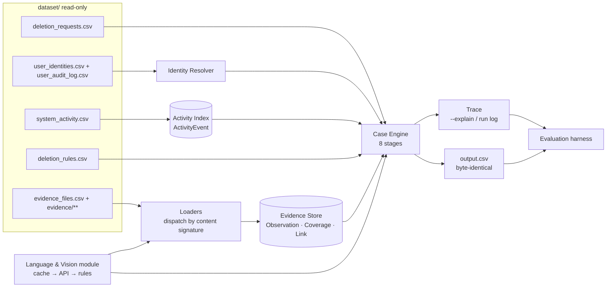
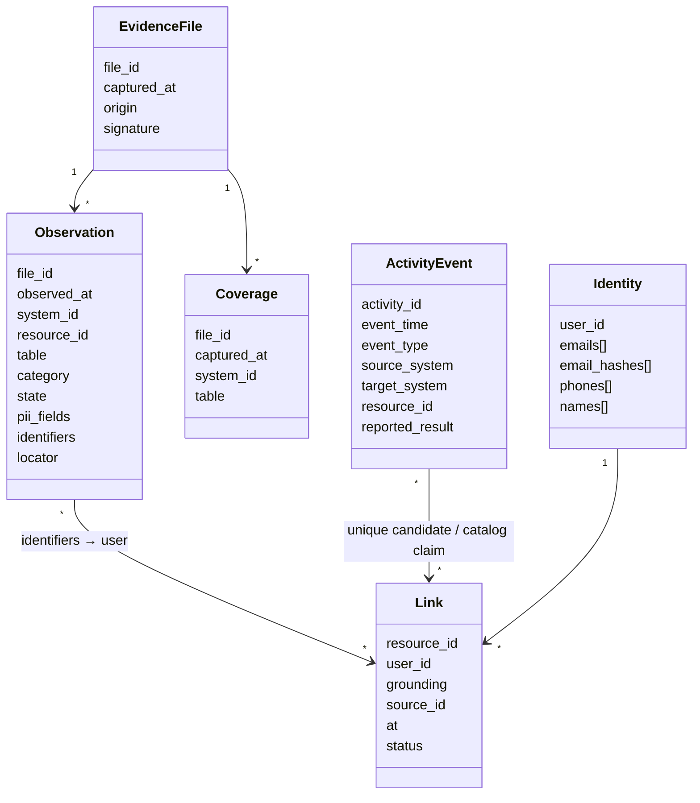
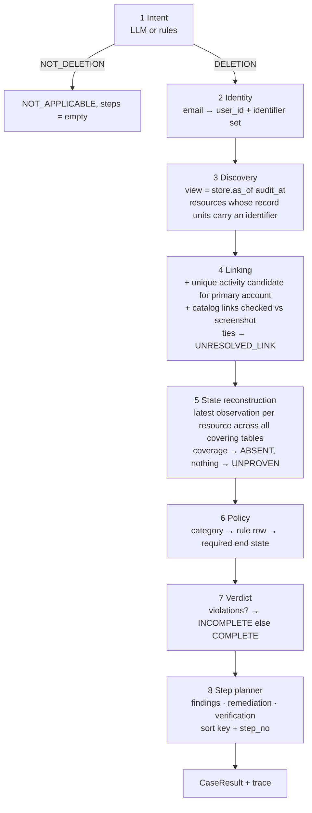
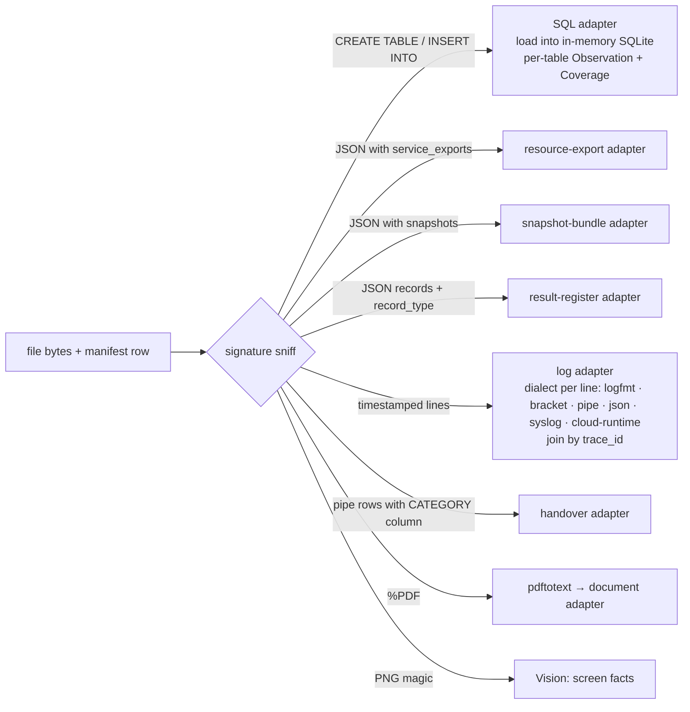
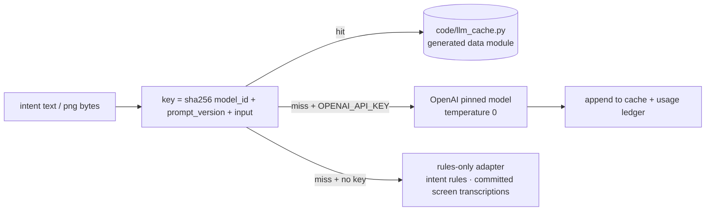
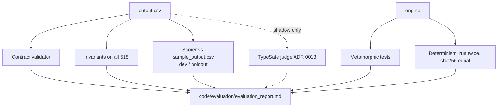

# 03 — Solution design: Ghost Data Still Exists

**Status:** design only, no code yet. Every decision here is bound by an ADR in `docs/adr/`, cited as **[ADR nnnn]**. The terms used are defined in `CONTEXT.md`.

The design vocabulary follows `.claude/skills/codebase-design`:

- *module*, *interface*, *depth*, *seam*, *adapter*;
- a seam is introduced only where **two or more adapters** really vary across it.

Owner principles: evidence over claims; strict cutoff; never attribute without a grounded link; absence of proof is not proof of absence; deterministic; models only for language and vision.

---

## 1. Shape of the system



There is one deep module per box. Callers learn only these interfaces:

| Module | Interface (everything a caller must know) | Hidden behind it |
| --- | --- | --- |
| **Loaders** | `load_all(manifest) -> LoadResult` (observations, coverage, links) | About 15 file schemas, 7 log dialects, trace_id joins, SQL replica tables, PDF text, screenshot extraction |
| **Evidence Store** | `store.as_of(cutoff) -> CaseView`. A view exposes `observations(resource)`, `latest(resource)`, `proves_absent(system, resource)`, `resources_linked_to(identity_set)` and `links(resource)` | Indexing, file-level cutoff filtering [ADR 0002], latest-observation ordering, closed-world coverage |
| **Activity Index** | `activity.as_of(cutoff)`, giving `account_delete_candidates(request)` and `category_claim(resource)` | Window and result matching [ADR 0003], event-type → category claim [ADR 0009] |
| **Identity Resolver** | `resolve(email) -> Identity` (user_id + identifier set) | Lowercasing, audit-chain history, sha256 of every email, phone normalisation, exact-match-only [CONTEXT: look-alike decoy] |
| **Case Engine** | `audit(case) -> CaseResult` (status, steps, trace) | The 8 stages in §3 |
| **Language & Vision** | `intent(text) -> Intent`, `screen(png) -> ScreenFacts` | Pinned models, the committed cache, the rules-only fallback, the usage ledger [ADR 0008] |

**The cutoff is structural.** The engine never holds the whole store; it only ever receives `store.as_of(case.audit_at)`. A later file cannot leak in through a forgotten filter, which enforces ADR 0002 by construction.

---

## 2. Data model



The rules that bind this model:

- **`Observation.state`** is set *only* by loaders from file content. An `ActivityEvent` can never create or change a state [ADR 0003, 0006].
- **`Coverage`** is emitted only when a snapshot provably lists a whole table. Examples: a SQL table dump, a `snapshot_bundle` collection (including `records: []`), and the per-system scope in `snapshot_scope`. ABSENT then means "covered and not listed" [CONTEXT: closed-world absence].
- **Replica drift falls out of the model.** A primary table and a replica table are separate `Observation`/`Coverage` sets. "Absent" requires absence from **every** covering table in the latest usable snapshot [CONTEXT: replica drift].
- **`Link.status = CONTRADICTED`** is set when a screenshot's visible identifiers resolve to someone else or to no known user. Contradicted links are never used [ADR 0005].
- **`Link.status = UNCONFIRMED`** is a catalog claim whose artifact neither confirms nor refutes it (e.g. activity_4007). It counts as grounded **only** if the referenced artifact shows the resource; otherwise the link is logged.

---

## 3. The per-case engine: 8 stages

Each stage is a pure function `(case, view, previous stage result) -> stage result + trace entries`. The stages are internal seams used by the module's own tests; the module's interface stays `audit(case)`.



### Stage 1, Intent [ADR 0008]

- `intent(request_text)` returns `DELETION` or `NOT_DELETION`, plus a short reason.
- The rules-only adapter covers the 17 deletion templates in 6 languages, plus negation and scope cues ("not asking for deletion", "do not close", "marketing lists only", "leave … in place").
- An optional TypeSafe shadow vote is **logged only** [ADR 0013].

### Stage 2, Identity

- Exact, case-insensitive resolution through the snapshot and the audit chain.
- If no user resolves, the case is logged as `UNRESOLVED_SUBJECT` and gets INCOMPLETE with no steps. It is not NOT_APPLICABLE, because the intent was deletion. This was measured to be 0 eval cases.

### Stage 3, Discovery

- The resources whose record units in the cutoff view carry any identifier of the subject.
- The grounding is `SAME_RECORD` or `TRACE_JOIN` (log lines sharing a trace_id).

### Stage 4, Linking

1. **Primary account, when not discovered directly:** take the unique survivor of the activity window and result match, then the pre-audit identity filter, then the **global one-to-one elimination across all 550 requests**, computed once per run [ADR 0003].
2. **Ties** produce no link and are logged as `UNRESOLVED_LINK` [ADR 0004].
3. **Catalog links** (`LINK_RESOURCE_IDENTITY`) are checked against their artifact [ADR 0005].
4. **Never:** case_id order, file membership, or fuzzy names [ADR 0004, 0007].

### Stage 5, State reconstruction

For each linked resource, take the **latest** observation at or before `audit_at` across every covering table:

- **ABSENT** comes from a 404 / NOT_FOUND / rows=0 observation, or from coverage that omits the resource.
- **PRESENT** comes from a row or a hit. In-file ordering by `observed_at` matters: `evidence_30` account_2088 goes 404 → 200.
- **EXPOSED** means the resource is PRESENT with non-null direct identifiers that policy says to remove.
- **UNPROVEN** means no observation and no coverage [ADR 0006].

### Stage 6, Policy

Category precedence [ADR 0009]:

1. explicit tag;
2. artifact content (an uploaded file → attachment; a hash-keyed contact lookup → SECONDARY_IDENTIFIER);
3. activity event-type claim;
4. system default (`search_service` → SEARCH_INDEX_ENTRY, and so on).

Then `deletion_rules.csv` gives the required end state:

| Category → action | Violation found → finding / remediation / verification | Already compliant → verification |
| --- | --- | --- |
| USER_PROFILE, SECONDARY_IDENTIFIER, SEARCH_INDEX_ENTRY, SUPPORT_ATTACHMENT, USER_EXPORT → **DELETE** | REPORT_REMAINING_RECORD / DELETE_RECORD / VERIFY_RECORD_ABSENT | VERIFY_RECORD_ABSENT |
| SUPPORT_MESSAGE, ACCOUNT_TOMBSTONE → **REDACT** | REPORT_EXPOSED_PII / REDACT_RECORD / VERIFY_RECORD_REDACTED | VERIFY_RECORD_REDACTED |
| ANALYTICS_PROFILE → **ANONYMIZE** | REPORT_EXPOSED_PII / ANONYMIZE_RECORD / VERIFY_RECORD_ANONYMIZED | VERIFY_RECORD_ANONYMIZED |
| SECURITY_AUDIT_LOG, LEGAL_HOLD_RECORD → **RETAIN** | (if missing: no finding op exists) | VERIFY_RECORD_PRESENT [ADR 0011] |
| BACKUP_ARCHIVE → **RETAIN + block restore** | REPORT_RESTORE_RISK / BLOCK_RESTORE / VERIFY_RESTORE_BLOCKED | VERIFY_RESTORE_BLOCKED |
| Data flow (connector) enabled | REPORT_ACTIVE_DATA_FLOW / DISABLE_DATA_FLOW / VERIFY_DATA_FLOW_DISABLED | VERIFY_DATA_FLOW_DISABLED |
| CACHE_ENTRY, EMAIL_DELIVERY_LOG, PRODUCT_TELEMETRY, unlinked MARKETING_PROFILE | no steps; logged `NOT_OBSERVABLE` [ADR 0012] | — |
| DELETION_PENDING account | treated as PRESENT under rule_01 (unlabeled) [ADR 0010] | — |

### Stage 7, Verdict [ADR 0006]

- **INCOMPLETE** if any grounded violation exists.
- **COMPLETE** otherwise, provided that every emitted verification is evidence-backed.
- **Unproven resources:**
  - In an INCOMPLETE case, they become future VERIFY steps.
  - In a no-violation case, they are omitted and logged as `UNPROVEN`.

### Stage 8, Step planner

- **Evidence citation.**
  - Findings, and verifications in COMPLETE cases, cite the **latest usable file that names the resource**, or for closed-world absence, the latest covering file.
  - Remediation, and verifications in INCOMPLETE cases, use `""`.
- **Sort key:** `(op_rank 1..15, system_id, resource_id)`, then `step_no = 1..n`. This was validated on 32/32 samples. The `resource_id` collation is open (A2), so plain string order is used.
- **Rows:** sorted by numeric case_id [ADR 0001].
- **Serialisation:** compact JSON (`separators=(",", ":")`), with keys in schema order. Fixed.

---

## 4. Loaders: dispatch by content signature



- **The seam is real.** There are about 9 adapters behind `load(file) -> LoadResult`. Dispatch reads content (magic bytes, top-level keys, line grammar), **never the file name**.
- An unknown signature is a hard error in the validator, so a format cannot be skipped silently.
- Each adapter emits a `locator` (line number or JSON path) for `--explain`.

---

## 5. Language & Vision module [ADR 0008]



- **Pinned models:** `gpt-5.4-mini-2026-03-17` for intent and `gpt-5.4-2026-03-05` for vision. These are recorded IDs; they will be checked against the provider before the first live call.
- **Prompts** live in `code/prompts/intent.md` and `code/prompts/screen.md`, versioned by a `prompt_version` header.
- **Cache:** the generated `code/llm_cache.py` holds `CACHE = {key: {...}}`, a Python literal with sorted keys. It is **not** `.json`/`.jsonl`/`.csv`: a Python data module keeps the cache reviewable as code, whereas data files such as `.json` are commonly excluded from code review and indexing tooling.
- **Usage ledger.** Every live call appends `(model, input_tokens, output_tokens, cost_estimate)` to the run ledger. `code/evaluation/usage_report.md` is generated from the final full run (calls, tokens, totals and averages per request, cost per model and overall).
- **The seam is real for intent** (API adapter, cache adapter, rules adapter) and **for vision** (API adapter, committed-transcription adapter). With no key, all 518 rows are still produced.

---

## 6. Determinism and explainability

- **Same inputs give a byte-identical `output.csv`:**
  - no wall-clock reads and no randomness;
  - every iteration is over sorted collections;
  - the global account assignment runs in a fixed order (by `reported_at`, then numeric case_id, used **only** as the processing order; it never breaks a tie [ADR 0004]);
  - fixed JSON serialisation;
  - LLM answers come from the cache.
- **`python3 code/main.py --explain case_X`** prints, for every step:
  - the stage that produced it;
  - the observations used (file_id, locator, observed_at, state);
  - the link and its grounding;
  - the rule row and the category source (tag / content / activity claim);
  - the reason the evidence was picked.
- It also prints what was rejected: post-cutoff files, contradicted links, ties, `NOT_OBSERVABLE` and `UNPROVEN` items.
- **The run log** (`code/evaluation/run_log.md`, Markdown so it is readable alongside the code) lists every `UNRESOLVED_LINK`, `NOT_OBSERVABLE`, `UNPROVEN` and `CONTRADICTED_LINK` with case IDs, plus the count of unlabeled-assumption cases [ADR 0010, 0011].

---

## 7. Evaluation harness



### Contract validator

- Header and column order; 518 rows; unique case_ids; numeric sort.
- Status vocabulary; `steps_json` is valid JSON with exactly the 7 keys.
- Only the 15 (phase, operation, state) triples; consecutive `step_no`; phase order; sort key.
- NOT_APPLICABLE ⇔ `[]`.
- COMPLETE has only VERIFICATION steps, each with non-empty evidence.
- INCOMPLETE remediation and verification steps have `""` evidence; findings have non-empty evidence.

### Invariants on all 518

- Every cited `evidence_id` exists in the manifest and is captured at or before that case's `audit_at`.
- No step cites an activity or audit ID as state proof [ADR 0006].
- No `case_id` literal and no gold resource ID appears in `code/` (a grep test).
- Nothing reads `sample_output.csv` outside `code/evaluation/`.

### Scorer

- Metrics: case status accuracy, step precision/recall/F1 (exact 7-field match ignoring `step_no`), field-level accuracy on aligned steps, sequence accuracy (exact order match, plus LCS ratio).
- **Split:** dev = 22 samples, holdout = 10 (a fixed list in the evaluation code, chosen to keep the status mix). Tuning looks at dev only; holdout is reported.

### Metamorphic tests

| Transformation | Expected |
| --- | --- |
| Shuffle the input row order | identical output |
| Uppercase the request email | identical |
| Add a `.jr` look-alike row to a file | identical |
| Remove a file captured after `audit_at` | identical for that case |
| Move `audit_at` to just before the cited file's `captured_at` | that citation disappears or changes |
| Swap a screenshot's visible email to an unknown person | the link becomes CONTRADICTED and its steps vanish |

### Custom cases

At least 3 hand-built cases for the report: a replica-only account, a DELETION_PENDING account, and a contradicted screenshot link.

### Determinism

Two full runs, then compare the `sha256(output.csv)` values; the check fails on any difference.

---

## 8. Code layout (`code/` only goes into code.zip)

```text
code/
├── main.py                  # CLI: run all → output.csv at repo root; --explain case_X
├── ghostaudit/
│   ├── loaders/             # signature sniffing + one adapter per shape
│   ├── store.py             # Evidence Store + CaseView (cutoff by construction)
│   ├── activity.py          # Activity Index, account candidates, category claims
│   ├── identity.py          # Identity Resolver
│   ├── engine/              # 8 stages + audit(case)
│   ├── policy.py            # deletion_rules.csv → required end state
│   ├── planner.py           # steps, citation choice, sort, serialisation
│   ├── language.py          # intent + vision seam, cache, ledger, rules fallback
│   └── trace.py             # explain + run log
├── prompts/intent.md, prompts/screen.md
├── llm_cache.py             # GENERATED, committed
└── evaluation/
    ├── main.py              # validator, invariants, scorer, metamorphic, determinism
    ├── evaluation_report.md # generated + hand-written sections
    ├── usage_report.md      # generated from the final run ledger
    └── run_log.md           # generated
```

- `code.zip` = `README.md` + `code/`.
- It never contains `dataset/`, `.env`, caches of dependencies, or nested archives.
- Paths resolve relative to the repo root (AGENTS.md §8).
- The standard library is enough except `pdftotext` (poppler) for PDFs. A committed PDF-text fallback is not needed, because the PDFs are read at run time.

---

## 9. Build order: thin vertical slices

Each slice ends with a passing `code/evaluation/main.py` and an unchanged determinism hash.

1. **Skeleton end-to-end.** Read requests; intent by rules only; NOT_APPLICABLE vs empty INCOMPLETE; writer with numeric sort and the contract validator. Gives 518 valid rows.
2. **Identity + one loader (handover txt) + planner.** Covers sample case_11, case_13 and case_14.
3. **SQL adapter with replica tables and coverage.** case_05, case_16 and case_22, plus the DELETION_PENDING assumption.
4. **Resource-export and snapshot-bundle JSON adapters.** case_21 and case_23 to case_32, tombstones.
5. **Log adapters (all dialects, trace_id join).** case_03, case_12, case_15, case_17 to case_20.
6. **Activity linking:** unique account candidate, global elimination, ties logged. All verification accounts.
7. **Category precedence:** support message vs attachment, analytics vs secondary identifier.
8. **PDFs and screenshots** (committed transcriptions first, vision adapter second) plus catalog-link checks. The 42 h family.
9. **The live LLM path** (cache, ledger, usage report), and the TypeSafe shadow and evaluation hooks.
10. **Metamorphic tests, the evaluation report, and README.** Package `code.zip`.

---

## 10. Accepted losses (estimated)

| Loss | Why accepted | Estimated cost |
| --- | --- | --- |
| Tied primary-account candidates are omitted | ADR 0004: no grounded link | 136 eval cases; about 136–160 steps (about 5% of about 3,050) |
| Already-anonymized analytics IDs with no pre-audit link | Only recoverable through the rank artifact | About 110 VERIFY_RECORD_ANONYMIZED steps in COMPLETE-style eval cases |
| Gold resources with no visible source at all (e.g. audit_record_6645/5569, account_004) | Unreachable | A few steps per affected case; samples show 3/32 |
| Strict file-level cutoff drops pre-audit sub-snapshots | ADR 0002 | 2/32 sample account hits; similar small eval share |
| Cache, email-log and telemetry categories | Not observable [ADR 0012] | Unknown; 0 in samples |
| Unlabeled assumptions: DELETION_PENDING (8 cases), legal holds (6) | No sample label [ADR 0010, 0011] | Up to 14 cases at risk if gold reads them differently |
| `resource_id` collation (A2) | Untested by samples | Order errors only where two steps share an op and a system |
| Unproven resources in a no-violation case are omitted [ADR 0006 edge] | Unlabeled | Possibly a missing VERIFY step, or a status disagreement |

---

## 11. The three weakest points of this design

1. **Content-signature loaders are the single point of failure.**
   - About 15 schemas and 7 log dialects are hand-recognised from 94 files. Any record unit the loaders misparse becomes either a missed finding or a false ABSENT through closed-world coverage.
   - Coverage is the riskiest piece: declaring a table "complete" when a snapshot only lists a sample of rows would turn missing data into false compliance.
   - Mitigations: coverage only for formats proven exhaustive (SQL table dumps, `snapshot_scope`, bundle collections), per-loader golden tests on every sample-cited line, and the hard-error policy for unknown signatures. The risk remains the largest.
2. **Primary-account linking depends on timing regularities in one regime.**
   - The window and result match are fitted to the 23 generated samples (0.75–1.23 h) and extrapolated to 506 eval rows. If the eval set has edge cases outside the window, they silently drop to `UNRESOLVED_LINK`.
   - The global one-to-one elimination couples cases: one wrong evidence link can cascade into another case's account.
   - Mitigations: log every elimination chain in `--explain`, report the candidate-count distribution on every run, and keep the window as a single named constant validated on dev/holdout.
3. **Verdict rules for unlabeled situations are reasoned, not measured.**
   - DELETION_PENDING, legal holds, the "unproven in a no-violation case" edge, and the 42 h screenshot family all rest on the ADRs, not on gold labels.
   - Measured: the samples contain no NOT_APPLICABLE example, no legal-hold step, no DELETION_PENDING row and no contradicted link.
   - Status accuracy on these roughly 35 eval cases is therefore unknown. The scorer cannot detect a systematic misreading.
   - Mitigation: the run log lists every case decided by an unlabeled rule, and the evaluation report states them as assumptions with counts.
